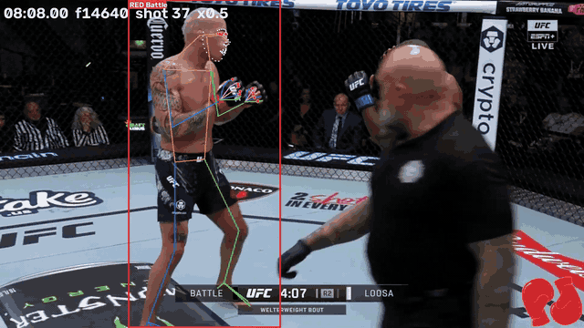
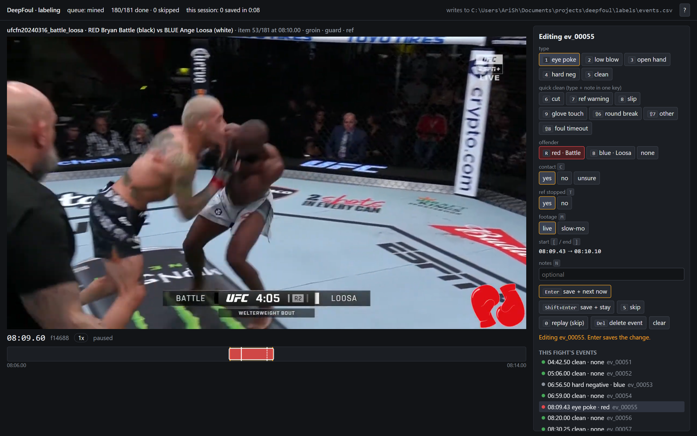
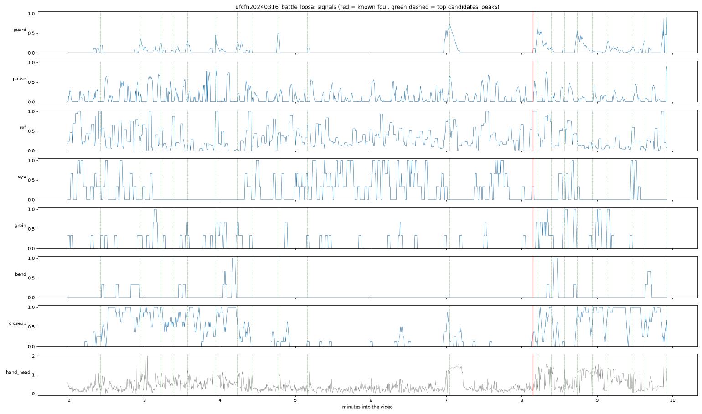
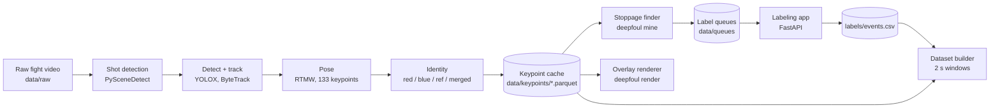
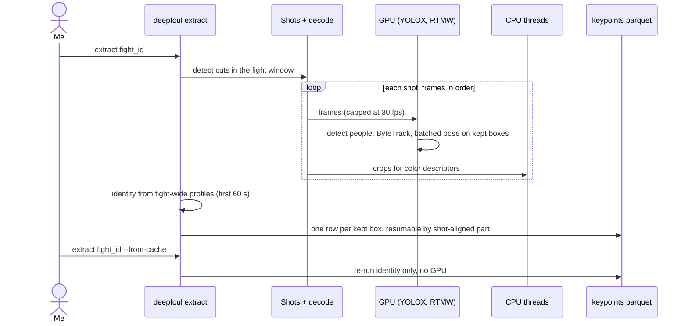

<div align="center">

# DeepFoul

**Computer vision that watches recorded MMA fights and flags likely eye pokes and low blows for a replay official to review.**


</div>

<!-- TODO: record/capture this (a short render of the overlay with skeletons and corner tags, from `deepfoul render`) -->


**Tech:** Python 3.11 · RTMW pose (rtmlib, ONNX Runtime) · ByteTrack · OpenCV · FastAPI · pandas / Parquet

---

## Overview

Whether a foul gets called in MMA depends on whether the referee happens to see it. Eye pokes happen roughly once every 14 UFC fights and regularly turn into no-contests, and a ref watching from one angle in real time can miss a finger or a knee that is obvious on replay.

DeepFoul is a system that tracks both fighters, reads their body pose frame by frame, and flags moments that look like an eye poke, a low blow, or an open hand reaching toward the opponent's face. It flags clips for a human to review and never makes the call itself (think VAR, not goal-line tech). I'm building it solo and in the open. The perception pipeline and the data engine are finished and the detector is next, so there are no detection results yet. It is built as a module that could plug into a combat sports CV system: same red/blue corner convention, same event-log style output, and no affiliation with Jabbr.

## Features

**It tells the two fighters apart from the ref and the crowd.** Each fight learns a color profile for both fighters (shorts and torso) and for the ref, then labels every person in every frame as `red`, `blue`, `ref`, `merged` (a clinch) or `none`.

**It reads a 133-point skeleton, fingers included.** Whole-body pose gives fingertips, eye contours and feet for each fighter, which is what an eye poke or a low blow is made of. Keypoints are cached once per fight, so everything downstream runs without the GPU.

**It finds candidate foul moments on its own.** A stoppage finder ranks moments from the keypoint cache, and extra queues pull in strikes that landed near the face or groin with no stoppage (hard negatives) and random moments (unbiased clean footage).

**Labeling takes seconds per moment.** A local labeling app plays a clip around each candidate and saves a label with one or two key presses. Every save is fsynced to `labels/events.csv`.

**Training data comes with an audit.** `deepfoul build-dataset` turns labels and reviewed clips into 2 second windows, refuses test fights, and re-runs a label audit on every build.

## Results

- Runs a full detect, track, pose and identity pass at 10.2 fps on an 8 GB RTX 2080, using 3.1 GB of VRAM (`deepfoul bench`).
- Keypoints are cached for all 13 non-test fights, about 405k processed frames, in one overnight run of 11h15m.
- The stoppage finder puts 7 of 8 known train fouls in its top 20 candidates per fight, up from 3 of 8 untuned. On the 6 known fouls in the val fights, which were never used for tuning, it gets 3 of 6.
- The dataset builder produces 1599 train windows: 32 eye poke, 89 low blow, 61 open hand, 100 hard negative and 1317 clean.
- 196 tests pass, plus 2 strict xfails that document the known clinch failures.

## Tech Stack

| Layer | Technology | Notes |
| ----- | ---------- | ----- |
| Language | [Python 3.11](https://www.python.org/) | Managed with [uv](https://docs.astral.sh/uv/), pinned by `.python-version` and `uv.lock`. |
| Pose and detection | [rtmlib](https://github.com/Tau-J/rtmlib) | RTMW whole-body pose (133 keypoints) and its bundled YOLOX person detector, both as ONNX models. |
| Inference runtime | [ONNX Runtime](https://onnxruntime.ai/) | `onnxruntime-gpu` with CUDA and cuDNN from pip wheels on Windows, CPU build on the Mac. |
| Tracking | [trackers](https://github.com/roboflow/trackers) | `ByteTrackTracker`, reset at every camera cut. |
| Drawing | [supervision](https://github.com/roboflow/supervision) and [OpenCV](https://opencv.org/) | Box, corner tag and skeleton overlays in `deepfoul render`. |
| Shot detection | [PySceneDetect](https://www.scenedetect.com/) | `AdaptiveDetector` tuned to a 2.0 ratio and a 30 content floor. |
| Data | [pandas](https://pandas.pydata.org/) and [PyArrow](https://arrow.apache.org/docs/python/) | One Parquet file per fight for keypoints, plus the windows index. |
| Labeling app | [FastAPI](https://fastapi.tiangolo.com/) and [Uvicorn](https://www.uvicorn.org/) | Streams the raw video with HTTP Range requests, plain HTML and JS on the front end. |
| CLI | [Typer](https://typer.tiangolo.com/) | The `deepfoul` command. |
| Charts | [Matplotlib](https://matplotlib.org/) | Stoppage signal plots and extraction reports. |
| Tests | [pytest](https://docs.pytest.org/) | Rules, geometry, windowing and labeling run on synthetic keypoints, not video. |

## Screenshots

<!-- TODO: record/capture this (labeling app mid-label: video, timeline with the draft span, and the label panel; avoid committing a UFC frame, see CLAUDE.md data rules) -->
**Labeling app:** one candidate moment with the clip timeline, the draft span and the keyboard-driven label panel.


**Stoppage finder signals:** the seven signals over a whole fight (Battle vs Loosa), with the known eye poke in red and the top candidates as dashed green lines.


## Architecture



Perception runs once per fight and everything else reads the cache. Identity is a separate last step, so I can change how fighters are assigned to corners and re-run it from the cache with `extract --from-cache` in about 2 minutes per fight, without touching the GPU.

## Engineering Decisions

**Assigning corners from fight-wide color profiles, not from track IDs.** Trackers hand out an ID per person, but IDs restart at every camera cut, swap in a clinch and get taken by the ref when they walk in front of a fighter, so an ID is not a corner. Resetting the tracker at every cut was only the first step (`cut_guard_frames` skips the blended frames around each cut). `perception/identity.py` learns a shorts and torso profile for each fighter, and a clothed-shins profile for the ref, from the first 60 seconds of each fight, then assigns `red`, `blue`, `ref`, `merged` or `none` to every box and smooths the label within a tracklet. The result is correct through cuts, ref crossings and re-entries on the golden set. The cost is a 60 second profile window, which a live version would need as a calibration delay.

**Dropping a width gate that fixed the wrong thing.** In close-ups of one fighter, such as a doctor check after a foul, the box would stay labeled `merged` for the whole shot. The obvious fix was to reject a merged box that is not much wider than one fighter, and I wrote it (at least 1.25x either fighter's last separate width). It broke real clinches: golden_04 went from 93% to 74% both-or-merged and corner jumps went from 3 to 16. Measuring the box widths showed why. A real clinch box is about one fighter wide (median 1.04 to 1.07x) because a tied-up pair is compact, and the sticky close-ups measured 1.12x. I reverted it, wrote the intended behavior into the `apply_merges` docstring and two strict-xfail tests in `tests/test_identity.py`, and left the problem for the error-driven fixes section with the evidence attached.

**Finding stoppages with one signal that works, and refusing to tune on val.** I expected a weighted mix of seven signals (pause, ref speed, hand on own eye or groin, bend and others) to find foul stoppages. Untuned, it put 3 of 8 train known fouls in the top 20. A weight grid found nothing that beat the guard signal alone: when the ref steps in, both fighters' hands come off their heads, and nearest-hand-to-head distance jumps from about 0.3 to over 1.0 torso lengths at every known stoppage. `mining/signals.py` now ranks on `guard` only, with a 10 second guard-up history and a queue time 3 seconds before the peak (hands drop about 3 seconds after the foul), which gets 7 of 8 on train. Some weight combinations scored 4 of 6 on the val fights instead of 3 of 6, and I did not pick one, because choosing it would be tuning on val.

**Making the lookahead a tested invariant, not a convention.** The design rule is that a decision at time `t` may use frames only up to `t + lookahead_s` (2 seconds), so a live version is a matter of swapping the input source. A rule like that is easy to break by accident with a rolling window or a median. `tests/test_mining.py::test_signals_use_at_most_the_lookahead` changes everything after `t + 2 s` and asserts the signals at `t` do not move. Motion is measured hip-relative and per tracklet, so camera pans do not count as movement and a Garbrandt-Long frame that repeats the previous one (a 25 fps source padded to 60) does not read as the fighters stopping.

**Taking clean footage only from time a human reviewed.** The easy way to get negatives is to call everything unlabeled clean. That would turn every missed foul and every replay into a wrong negative. `dataset/build.py` takes clean windows only from clips I reviewed in the mined, hardneg and random queues, or from a whole fight once it has full-fight labels, and it drops timeouts, round breaks and replays by reading the note field (`dataset.note_categories`, whole-word match, so "uppercut" is not "cut"). Windows near a foul are dropped within a per-class buffer, so wind-up and reaction are neither the event nor clean. Test fights are refused with an assert. The tradeoff is a known bias: today's clean windows come mostly from mined clips (clinches, stoppages), which is why the random queue exists.

## What's Next

- **The evaluation harness (3.1).** Event matching within +-1.0 s and per-foul-type recall, precision and false flags per fight, with dummy always-flag and never-flag detectors as a sanity check. Val fights get labeled first, so a foul I missed does not show up as a fake false flag.
- **The feature layer and rule detectors (3.2, 3.3).** Fingertip-to-eye-zone and foot-to-groin-zone distances in torso lengths, plus reaction features (hand to own face, bend at the waist), feeding `open_hand`, `eye_poke` and `low_blow` rules. The eye zone has to come from the head, not the eye points alone, because a victim's eye keypoints drop out during the poke itself.
- **Clinch handling.** A merged box gets one skeleton, so a low blow at contact has no per-fighter pose for the victim. The candidate fix is to run pose on each fighter's last known box while merged. `labels/golden_baseline.csv` already lists golden_04's clinch as a known failure.
- **A learned classifier.** LightGBM on window features first, then a small PyTorch temporal model, compared against the rules on val, with the Gane fights held out as the test set until the end.

<details>
<summary><b>Technical deep dive</b></summary>

**Core mechanic:** a fight video becomes a per-frame table of fighter boxes with a corner label and 133 keypoints, cached once; mining, labeling, rendering and dataset building all read that table instead of the video.

### Extraction sequence



### Architecture notes

- **Timestamps always refer to the original download.** The raw videos are never trimmed or re-encoded. `deepfoul fetch` rebuilds `data/raw/` on any machine from `labels/fights.csv`, so a label made on the Mac lines up with a cache built on the PC. A fight's `action_start_s` / `action_end_s` skip intros and interviews instead.
- **A decision at time `t` sees only up to `t + lookahead_s`.** `mining/signals.py` computes every signal on a 0.25 s grid and looks at most `after_s` ahead. The past is free. Identity has one known exception: the fight profile uses the first 60 seconds, which a live version would need as a calibration delay.
- **Geometry is in torso lengths and low-confidence keypoints are masked.** Features are scale-free, so zoom level does not matter, and a point under `kpt_conf_min` (0.3) is never drawn or trusted.
- **Splits are by fight, never by clip.** `assign_splits` in `dataset/build.py` reads each fight's split from `fights.csv`, errors on an unknown fight, and `build()` asserts that no `test` window exists. `mine --check` scores val fights in memory and never queues them.
- **A merged box keeps its `raw_label`.** When two fighters become one `merged` box the cache still stores the corner each box had before merging, and `window_keypoints()` sends a merged box to that side.
- **Extraction is resumable and idempotent.** `perceive_span` runs per shot-aligned part, so an interrupted overnight run resumes from the last finished part, and `ingest` skips every stage that is up to date.
- **The labeling app writes safely.** `EventStore` appends one line, then flushes and fsyncs, and rewrites to a temp file plus `os.replace` for edits and deletes. A hard kill after 3 rows left all 3 intact. "Done" for a queue item is derived from the events file, so progress carries across machines.
- **Nothing hardware-specific lives in code.** `configs/default.yaml` picks a profile from detected VRAM (`small` for 6 GB and up, `large` for 16 GB and up, `cpu` on the Mac) that sets the pose model and batch size. `deepfoul doctor` reports which profile it picked and whether `CUDAExecutionProvider` is active.

### Route map

| Area | Routes |
| ---- | ------ |
| Page | `/`, `/static/*` |
| Session and fights | `/api/session`, `/api/fight/{fid}` |
| Video | `/video/{fid}` (HTTP Range, served straight from `data/raw/`) |
| Events | `/api/events` (GET, POST), `/api/events/{event_id}` (PUT, DELETE) |
| Queue state | `/api/skip/{item_id}`, `/api/done/{item_id}`, `/api/widen/{item_id}` |

### Project structure

```text
deepfoul/
├── configs/default.yaml      # thresholds, windows, paths, machine profiles
├── labels/                   # committed: fights, events, golden clips, baseline, known fouls
├── src/deepfoul/
│   ├── cli.py                # the `deepfoul` command
│   ├── io/                   # fetch (yt-dlp), frame reader, shot detection, probing
│   ├── perception/           # detect, track, appearance, identity, pose, extract
│   ├── mining/               # stoppage signals, miner, hard-negative and random queues
│   ├── labeling/             # FastAPI app, events store, queues, static HTML/JS
│   ├── dataset/              # training windows, summary, label audit
│   ├── viz/                  # overlay renderer and extract / identity reports
│   ├── ingest.py             # draft merge, fetch, extract, mine, report
│   └── bench.py              # per-stage timing
├── tests/                    # pytest on synthetic keypoints and temp CSVs
├── ROADMAP.md                # the plan, one section at a time
└── PROGRESS.md               # what was built, decisions, known issues
```

`data/` and `outputs/` are gitignored. Footage, clips and frames never get committed, only `labels/` metadata (URLs, timestamps, labels).

`src/deepfoul/` also has empty `eval/`, `features/`, `rules/`, `events/` and `models/` packages. They are reserved for the evaluation and detection sections that come next.

### Security

| Mechanism | Where |
| --------- | ----- |
| Labeling app binds to localhost only | `labeling:` in `configs/default.yaml`, `deepfoul label` |
| Every label field is validated before it is written (offender required for fouls, `0 <= start <= end`) | `validate_event` in `labeling/events_store.py` |
| Test fights are refused by the dataset builder | `build()` in `dataset/build.py` |
| Footage and generated data cannot be committed | `.gitignore` (`data/`, `outputs/`, `*.mp4`, `*.onnx`) |

</details>

<details>
<summary><b>Run it locally</b></summary>

### Prerequisites

- Python 3.11 and [uv](https://docs.astral.sh/uv/)
- `ffmpeg` and `yt-dlp` on your `PATH`
- Windows or macOS. An NVIDIA GPU is needed for a full extraction pass (8 GB is enough). On a Mac everything except extraction runs on CPU, and extraction falls back to a lighter model for short clips.
- Chrome or Edge for the labeling app (the raw videos use VP9 / AV1 with Opus audio in MP4)

### Setup

```bash
git clone https://github.com/ar1shah/deepfoul.git
cd deepfoul
uv sync                          # installs the pinned dependencies
uv run deepfoul doctor           # shows the detected GPU profile and whether CUDA is active
uv run deepfoul fetch            # downloads every video in labels/fights.csv into data/raw/
uv run deepfoul extract ufc258_barber_grasso   # pose + identity cache for one fight
uv run deepfoul label            # practice queue in the labeling app
```

The footage is not in the repo. `fetch` rebuilds it from the source URLs in `labels/fights.csv`, and a few fights have no public upload yet, so their `source_url` is blank.

### Useful scripts

| Script | Command |
| ------ | ------- |
| `uv run deepfoul extract --all` | Pose and identity cache for every downloaded non-test fight, train first. |
| `uv run deepfoul extract <id> --from-cache` | Re-run identity from the keypoint cache, no GPU. |
| `uv run deepfoul render <id> --start 14:00 --end 14:10 --skeleton` | Overlay video from the cache (`--speed 0.25` for slow motion). |
| `uv run deepfoul mine --all --check` | Rank candidate foul moments and check recall on the val fights. |
| `uv run deepfoul mine --hardneg` / `--random` | Build the hard-negative and random label queues. |
| `uv run deepfoul label --queue mined` | Label a queue. `--fight <id>` labels a whole fight. |
| `uv run deepfoul build-dataset` | Labels and reviewed clips to training windows, with a summary and audit. |
| `uv run deepfoul ingest` | Merge a draft fight list, then fetch, extract and mine in one go. |
| `uv run deepfoul bench` | Time each pipeline stage on a fixed span. |
| `uv run pytest` | Run the test suite. |

</details>

---

DeepFoul is an open source side project and portfolio piece, still in development, so there is no public live version. It runs locally against footage you download yourself, which is why the screenshots and the demo are the best look at it for now. It is not affiliated with Jabbr or DeepStrike.

Ari Shah · [Portfolio](https://www.ar13.dev/) · [LinkedIn](https://linkedin.com/in/arishah)

Apache-2.0 License, see [LICENSE](LICENSE).
